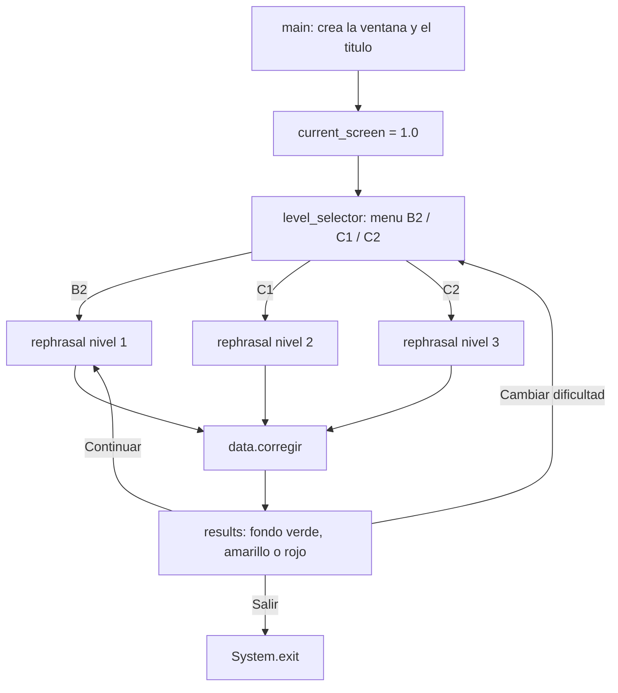
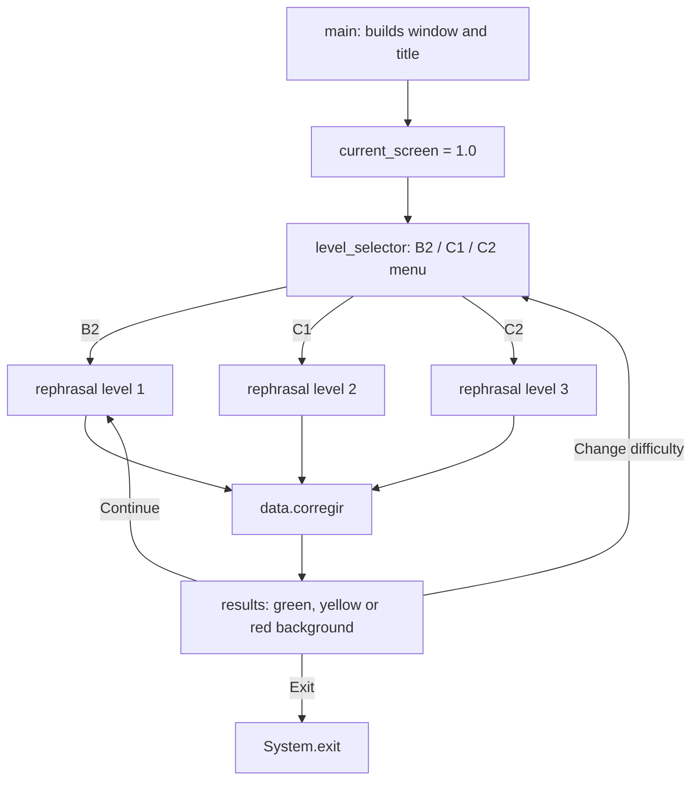

# Sotenglish

**Aplicación de escritorio para practicar inglés mediante transformaciones de frases (niveles B2 · C1 · C2)**

**Este archivo markdown fue hecho por IA, el codigo fue hecho por mi**

**Puedes ver el la lista con todas las frases [aquí](./docs/exercises.md), y [aquí](./docs/solutions.md) puedes ver las soluciones**

---

## Índice / Index

**_Español_**

1. [Descripción general](#es-descripcion-general)
2. [Requisitos](#es-requisitos)
3. [Compilación y ejecución](#es-compilacion)
4. [Estructura del proyecto](#es-estructura)
5. [Flujo de la aplicación](#es-flujo)
6. [Sistema de puntos y corrección](#es-puntos)
7. [Guía de uso](#es-guia-de-uso)
8. [Cómo añadir frases nuevas](#es-anadir-frases)
9. [Paleta de colores](#es-paleta)
10. [Limitaciones conocidas](#es-limitaciones)
11. [Hoja de ruta](#es-hoja-de-ruta)
12. [Curiosidades del código](#es-curiosidades)

**_English_**

1. [Overview](#en-overview)
2. [Requirements](#en-requirements)
3. [Build & Run](#en-build-and-run)
4. [Project Structure](#en-project-structure)
5. [App Flow](#en-app-flow)
6. [Scoring & Correction](#en-scoring)
7. [How to Use](#en-how-to-use)
8. [Adding New Sentences](#en-adding-sentences)
9. [Color Palette](#en-color-palette)
10. [Known Limitations](#en-known-limitations)
11. [Roadmap](#en-roadmap)
12. [Code Trivia](#en-code-trivia)

---
---

# PARTE EN ESPAÑOL

<a id="es-descripcion-general"></a>
## 1. Descripción general

Sotenglish es una aplicación de escritorio escrita en Java con la librería Swing. Su propósito es practicar inglés mediante ejercicios de **transformación de frases** (*rephrasing*), el formato clásico de *key word transformation* que aparece en los exámenes oficiales de Cambridge.

El mecanismo es directo: la aplicación muestra una frase original, una **palabra clave** destacada en negrita y una segunda frase incompleta con un hueco. El usuario debe reescribir la frase conservando el significado, empleando obligatoriamente la palabra clave, y confirmar el resultado. La aplicación evalúa la respuesta, ajusta la puntuación y muestra una pantalla de resultados cuyo color de fondo refleja lo acertado de la respuesta.

Existen tres niveles de dificultad: **B2**, **C1** y **C2**.

**Nota sobre el idioma:** la interfaz está íntegramente en español, pero los ejercicios son en inglés. Como el número de botones es mínimo y la mecánica es autoexplicativa, cualquier persona puede usar el programa sin manual previo, sin conocer el idioma de la interfaz y sin complicación alguna. La barrera de entrada es prácticamente nula.

**Estado actual:** versión funcional de escritorio, con dos ejercicios por nivel y sin dependencias externas.

<a id="es-requisitos"></a>
## 2. Requisitos

- **Java JDK 8 o superior** (el proyecto no usa funciones posteriores a Java 8).
- **Swing**, incluido en el JDK. No hay librerías de terceros ni gestores de dependencias.
- Sistema operativo: Windows, macOS o Linux.
- No requiere conexión a internet.

<a id="es-compilacion"></a>
## 3. Compilación y ejecución

El proyecto usa paquetes con nombres poco convencionales (`src.pc` y `src.shared`), donde la carpeta `src` forma parte del propio nombre del paquete. Por eso la compilación debe hacerse indicando la carpeta de salida.

**Desde la terminal (Linux / macOS):**

```bash
javac -d bin $(find src -name "*.java")
java -cp bin src.pc.sotenglish
```

**Desde la terminal (Windows):**

```bat
dir /s /b src\*.java > sources.txt
javac -d bin @sources.txt
java -cp bin src.pc.sotenglish
```

**Desde un IDE:** importar el proyecto como proyecto Java, marcar la carpeta `src` como *source root* y ejecutar la clase `src.pc.sotenglish` (que contiene el método `main`).

Al ejecutarse, se abre una ventana de **600 × 400 píxeles**, no redimensionable y centrada en la pantalla, con fondo oscuro.

<a id="es-estructura"></a>
## 4. Estructura del proyecto

El código se reparte en 7 clases con responsabilidades bien separadas entre lógica, datos y presentación.

| Archivo | Clase | Responsabilidad |
|:--------|:------|:----------------|
| `src/pc/sotenglish.java` | `sotenglish` | Punto de entrada. Contiene el estado global (pantalla actual, nivel, puntos) y construye la ventana principal. |
| `src/pc/window/screen.java` | `screen` | Enrutador de pantallas. Según el valor de la pantalla actual, delega en el menú o en el ejercicio. |
| `src/pc/window/level_selector.java` | `level_selector` | Menú de selección de dificultad con los botones B2, C1 y C2. |
| `src/pc/window/rephrasal.java` | `rephrasal` | Pantalla del ejercicio: enunciado, palabra clave, hueco, campo de texto y botón de confirmación. |
| `src/pc/window/results.java` | `results` | Pantalla de resultados con el feedback cromático y los botones Continuar, Cambiar dificultad y Salir. |
| `src/shared/data.java` | `data` | Banco de frases por nivel, accesores y lógica de corrección. |
| `src/shared/random.java` | `random` | Generador del índice aleatorio del ejercicio. |

**Separación por capas:** `data` y `random` (paquete `shared`) constituyen la capa de datos y lógica pura. `sotenglish`, `screen`, `level_selector`, `rephrasal` y `results` (paquete `pc`) constituyen la capa de presentación con Swing. Esta división es la que permitirá reutilizar el núcleo al desarrollar la versión para Android.

<a id="es-flujo"></a>
## 5. Flujo de la aplicación

El estado global `current_screen` (de tipo `float`) determina en todo momento qué pantalla está activa:

- `1.0` → menú de selección de nivel
- `2.1` → ejercicio de nivel B2
- `2.2` → ejercicio de nivel C1
- `2.3` → ejercicio de nivel C2



Secuencia detallada:

1. `main()` crea la ventana, aplica el fondo oscuro, coloca el título y llama a `screen.update()`.
2. Con `current_screen` en `1.0`, se dibuja el menú de niveles.
3. Al pulsar B2, C1 o C2, el manejador fija el nuevo valor de pantalla (`2.1`, `2.2` o `2.3`), asigna el nivel (1, 2 o 3) y vuelve a llamar a `screen.update()`.
4. `screen.update()` limpia el contenido de la ventana, vuelve a añadir el título y el marcador de puntos, e instancia `rephrasal` para dibujar el ejercicio.
5. El botón **Confirmar** envía la respuesta a `data.corregir()`.
6. `corregir()` calcula los puntos y delega en `results.results_chooser()`, que limpia la pantalla, muestra la frase original y la solución completa, y aplica el color de fondo correspondiente.
7. Los botones de resultados cierran el ciclo: **Continuar** genera otro ejercicio, **Cambiar dificultad** vuelve al menú y **Salir** termina el proceso.

<a id="es-puntos"></a>
## 6. Sistema de puntos y corrección

El método `corregir()` de la clase `data` evalúa la respuesta del usuario con tres ramas mutuamente excluyentes:

| Condición | Puntos | Resultado |
|:----------|:-------|:----------|
| La respuesta contiene **exactamente una** de las dos mitades de la solución | **+1** | Acierto parcial (fondo amarillo) |
| La respuesta **no coincide** con la solución completa | **−1** | Fallo (fondo rojo) |
| La respuesta **coincide exactamente** con la solución completa | **+2** | Acierto total (fondo verde) |

Detalles de implementación:

- La primera comprobación usa un **XOR lógico** (`^`) entre `contains(sol_pt1)` y `contains(sol_pt2)`. Si se cumplen las dos condiciones a la vez, el XOR da falso y se pasa a la siguiente rama; ahí es donde encaja la respuesta perfecta.
- La coincidencia exacta se comprueba con `equals()`, por lo que distingue **mayúsculas, minúsculas y espacios**.
- La solución se divide en dos mitades (`sol_pt1` y `sol_pt2`) precisamente para poder otorgar el punto de consolación.
- El marcador se refleja al instante en la etiqueta de puntos y **puede llegar a valores negativos**.
- Cada ejercicio reinicia la bandera `pts_set`, mientras que la puntuación acumulada se conserva durante toda la sesión.

<a id="es-guia-de-uso"></a>
## 7. Guía de uso

1. Ejecuta la aplicación. Aparece el título y el menú de dificultad.
2. Pulsa **B2**, **C1** o **C2** según el nivel que quieras practicar.
3. Lee la frase original y la palabra clave en negrita.
4. Escribe en el campo de texto la transformación completa, respetando el inicio y el final ya dados, y usando la palabra clave.
5. Pulsa **Confirmar**.
6. Observa el color de la pantalla de resultados: verde significa perfecto, amarillo significa que has acertado la mitad y rojo significa fallo. Se muestra la solución correcta.
7. Usa **Continuar** para otro ejercicio, **Cambiar dificultad** para volver al menú o **Salir** para cerrar el programa.

En total, el recorrido completo se maneja con un puñado de botones y ningún menú anidado: tres en el selector de nivel, uno en el ejercicio y tres en los resultados.

<a id="es-anadir-frases"></a>
## 8. Cómo añadir frases nuevas

Ampliar el banco de frases es una de las tareas previstas. Todo el contenido vive en la clase `data`, en los métodos `B2()`, `C1()` y `C2()`.

Cada frase se define en **siete arrays paralelos** que deben mantenerse perfectamente alineados por índice y con la misma longitud:

| Array | Contenido |
|:------|:----------|
| `enunciado` | La frase original en inglés. |
| `palabra` | La palabra clave, en mayúsculas. |
| `inicio` | El arranque de la frase transformada. |
| `sol` | La solución completa que debe escribir el usuario. |
| `sol_pt1` | Primera mitad de la solución (acierto parcial). |
| `sol_pt2` | Segunda mitad de la solución (acierto parcial). |
| `desenlace` | El cierre de la frase transformada. |

Además, la variable `total` debe actualizarse a `enunciado.length`.

Ejemplo de ampliación del nivel B2:

```java
void B2() {
    enunciado = new String[]{
        "Joan finds keeping grammatical rules in mind very difficult.",
        "I'm sorry I'm late, said Peter.",
        "It's a pity you didn't come to the party."          // nueva
    };
    palabra = new String[]{
        "EASY", "APOLOGISED", "WISH"                          // nueva
    };
    inicio = new String[]{
        "Joan says it", "Peter", "I"                          // nueva
    };
    sol = new String[]{
        "is not easy to keep",
        "apologised for being",
        "wish you had come"                                   // nueva
    };
    sol_pt1 = new String[]{
        "is not easy", "apologised", "wish you"               // nueva
    };
    sol_pt2 = new String[]{
        "to keep", "for being", "had come"                    // nueva
    };
    desenlace = new String[]{
        "grammatical rules in mind.", "late.", "to the party." // nueva
    };
    total = enunciado.length;
}
```

Recomendaciones al añadir frases:

- Escribe `sol` **exactamente** como debe teclearla el usuario: la comparación es literal.
- Si `inicio` o `desenlace` van vacíos, los accesores devuelven `"_"` para que la frase se siga leyendo bien.
- Mantén las dos mitades equilibradas para que el punto de acierto parcial sea significativo.
- Añade la misma frase en los tres niveles solo si encaja con la dificultad; lo ideal es que B2, C1 y C2 tengan estructuras gramaticales distintas.

<a id="es-paleta"></a>
## 9. Paleta de colores

La interfaz usa una paleta fija, con los colores definidos directamente en el código mediante `new Color(r, g, b)`:

| Color | RGB | Uso |
|:------|:----|:----|
| Fondo oscuro | `28, 30, 36` | Fondo base de la ventana. |
| Rojo oscuro | `130, 0, 0` | Botón de confirmación y botón B2. |
| Verde oliva | `139, 156, 21` | Botón C1. |
| Carmesí | `176, 28, 55` | Botón C2. |
| Amarillo | `255, 239, 35` | Botón Continuar. |
| Naranja | `255, 149, 0` | Botón Cambiar dificultad. |
| Azul | `41, 59, 149` | Botón Salir. |
| Verde | `34, 139, 34` | Fondo de resultado correcto. |
| Amarillo pálido | `253, 218, 13` | Fondo de resultado parcial. |
| Rojo carmín | `196, 30, 58` | Fondo de resultado incorrecto. |
| Blanco / Negro | `255, 255, 255` / `0, 0, 0` | Textos, adaptados al contraste de cada fondo. |

En los resultados parciales se fuerza el color negro en el título, el marcador y el enunciado para que sean legibles sobre el fondo amarillo, y se restauran a blanco al volver a una pantalla normal.

<a id="es-limitaciones"></a>
## 10. Limitaciones conocidas

- **Comparación literal:** `equals()` distingue mayúsculas y espacios, y no se aplica `trim()`. Una respuesta correcta con una mayúscula inicial o un espacio final se marca como fallo.
- **Sin atajo de teclado:** el campo de texto no responde a la tecla Intro; hay que pulsar el botón.
- **Repetición de ejercicios:** el generador aleatorio no lleva memoria, así que puede repetir la misma frase dos veces seguidas.
- **Banco reducido:** actualmente hay dos frases por nivel, lo que hace muy probable la repetición.
- **Sin persistencia:** los puntos se pierden al cerrar la aplicación.
- **Puntuación sin límites:** el marcador puede bajar hasta valores negativos.
- **Banco vacío:** si un nivel no tuviera frases, `rantask()` devolvería `0` y el índice apuntaría fuera del array.
- **Tamaño fijo:** la ventana no es redimensionable y las posiciones de los componentes están calculadas a mano para 600 × 400.
- **Estado estático:** los arrays de `data` y el estado de `sotenglish` son estáticos, lo que funciona con una sola ventana pero complicaría un uso multipantalla.

<a id="es-hoja-de-ruta"></a>
## 11. Hoja de ruta

Las dos líneas de desarrollo previstas son la **ampliación del contenido** y la **versión para Android**.

**Más frases**
- Aumentar el banco hasta decenas o cientos de ejercicios por nivel.
- Evitar la repetición consecutiva recordando el último índice generado.
- Valorar sacar las frases del código a un archivo externo (JSON o CSV) para poder editarlas sin recompilar.

**Versión para Android**
- La capa de datos (`data` y `random`) es independiente de Swing y se puede reutilizar casi tal cual.
- La capa de presentación hay que reescribirla con vistas nativas de Android (layouts, `EditText`, `Button`) o con un framework multiplataforma.
- El estado global estático debería sustituirse por una clase de estado propia de la actividad.
- Conviene adaptar la disposición a pantallas verticales y a densidades variadas, ya que las posiciones actuales están fijadas en píxeles.

**Mejoras adicionales candidatas**
- Ignorar mayúsculas y espacios sobrantes al corregir.
- Confirmar con la tecla Intro.
- Guardar la puntuación entre sesiones.
- Añadir un temporizador y estadísticas de acierto por nivel.

<a id="es-curiosidades"></a>
## 12. Curiosidades del código

- Cada color de botón va acompañado de un comentario con un fragmento de una cita numerada de los **Pecadores** de limbus company.
- El método que genera un ejercicio nuevo tras un acierto se llama `MerryGoRound`, en referencia al carácter cíclico del bucle de práctica.
- La ventana se abre siempre centrada con `setLocationRelativeTo(null)`, un detalle de acabado que se agradece.
- Los colores se declaran con `setContentAreaFilled(false)` junto a `setOpaque(true)` para que el fondo personalizado domine sobre el estilo nativo de Swing: un truco habitual para que los botones no se vean grises.
- La clase `random` envuelve `java.util.Random` en lugar de usarlo directamente, lo que aísla la generación del índice y facilita sustituirla.

---
---

# ENGLISH PART

<a id="en-overview"></a>
## 1. Overview

Sotenglish is a desktop application written in Java with the Swing library. Its purpose is to practise English through **sentence transformation** exercises (*rephrasing*), the classic *key word transformation* format found in official Cambridge exams.

The mechanism is straightforward: the app displays an original sentence, a **key word** shown in bold, and a second, incomplete sentence with a gap. The user must rewrite the sentence keeping the meaning, using the key word, and confirm the answer. The app evaluates the response, adjusts the score, and shows a results screen whose background colour reflects how accurate the answer was.

There are three difficulty levels: **B2**, **C1** and **C2**.

**A note on language:** the interface is entirely in Spanish, but the exercises are in English. Since the number of buttons is minimal and the mechanic is self-explanatory, anyone can use the program with no manual, no knowledge of the interface language, and no difficulty at all. The barrier to entry is practically zero.

**Current status:** working desktop version, with two exercises per level and no external dependencies.

<a id="en-requirements"></a>
## 2. Requirements

- **Java JDK 8 or higher** (the project uses no feature newer than Java 8).
- **Swing**, bundled with the JDK. No third-party libraries and no dependency manager.
- Operating system: Windows, macOS or Linux.
- No internet connection required.

<a id="en-build-and-run"></a>
## 3. Build & Run

The project uses unconventional package names (`src.pc` and `src.shared`), where the `src` folder is itself part of the package name. Compilation therefore has to specify an output folder.

**From the terminal (Linux / macOS):**

```bash
javac -d bin $(find src -name "*.java")
java -cp bin src.pc.sotenglish
```

**From the terminal (Windows):**

```bat
dir /s /b src\*.java > sources.txt
javac -d bin @sources.txt
java -cp bin src.pc.sotenglish
```

**From an IDE:** import the project as a Java project, mark the `src` folder as a *source root*, and run the class `src.pc.sotenglish` (which holds the `main` method).

On launch, a **600 × 400 pixel** window opens, non-resizable and centred on the screen, with a dark background.

<a id="en-project-structure"></a>
## 4. Project Structure

The code is split across 7 classes with clearly separated responsibilities between logic, data and presentation.

| File | Class | Responsibility |
|:-----|:------|:---------------|
| `src/pc/sotenglish.java` | `sotenglish` | Entry point. Holds the global state (current screen, level, points) and builds the main window. |
| `src/pc/window/screen.java` | `screen` | Screen router. Depending on the current screen value, it delegates to the menu or the exercise. |
| `src/pc/window/level_selector.java` | `level_selector` | Difficulty menu with the B2, C1 and C2 buttons. |
| `src/pc/window/rephrasal.java` | `rephrasal` | Exercise screen: prompt, key word, gap, text field and confirmation button. |
| `src/pc/window/results.java` | `results` | Results screen with colour feedback and the Continue, Change difficulty and Exit buttons. |
| `src/shared/data.java` | `data` | Sentence bank per level, accessors and correction logic. |
| `src/shared/random.java` | `random` | Random exercise index generator. |

**Layered split:** `data` and `random` (the `shared` package) form the pure data and logic layer. `sotenglish`, `screen`, `level_selector`, `rephrasal` and `results` (the `pc` package) form the Swing presentation layer. This split is what will make the core reusable when the Android version is built.

<a id="en-app-flow"></a>
## 5. App Flow

The global state `current_screen` (a `float`) determines which screen is active at all times:

- `1.0` → level selection menu
- `2.1` → B2 level exercise
- `2.2` → C1 level exercise
- `2.3` → C2 level exercise



Detailed sequence:

1. `main()` creates the window, applies the dark background, places the title and calls `screen.update()`.
2. With `current_screen` at `1.0`, the level menu is drawn.
3. Pressing B2, C1 or C2 sets the new screen value (`2.1`, `2.2` or `2.3`), assigns the level (1, 2 or 3) and calls `screen.update()` again.
4. `screen.update()` clears the window contents, re-adds the title and the score label, and instantiates `rephrasal` to draw the exercise.
5. The **Confirm** button sends the answer to `data.corregir()`.
6. `corregir()` computes the points and delegates to `results.results_chooser()`, which clears the screen, shows the original sentence and the full solution, and applies the matching background colour.
7. The results buttons close the loop: **Continue** generates another exercise, **Change difficulty** returns to the menu and **Exit** ends the process.

<a id="en-scoring"></a>
## 6. Scoring & Correction

The `corregir()` method in the `data` class evaluates the user's answer through three mutually exclusive branches:

| Condition | Points | Outcome |
|:----------|:-------|:--------|
| The answer contains **exactly one** of the two halves of the solution | **+1** | Partial hit (yellow background) |
| The answer **does not match** the full solution | **−1** | Miss (red background) |
| The answer **matches exactly** the full solution | **+2** | Full hit (green background) |

Implementation details:

- The first check uses a logical **XOR** (`^`) between `contains(sol_pt1)` and `contains(sol_pt2)`. If both conditions hold, the XOR yields false and execution falls through to the next branch; that is where the perfect answer lands.
- The exact match is checked with `equals()`, so it is **case- and whitespace-sensitive**.
- The solution is split into two halves (`sol_pt1` and `sol_pt2`) precisely so partial credit can be awarded.
- The score label updates instantly and **can go negative**.
- Every exercise resets the `pts_set` flag, while the accumulated score is kept for the whole session.

<a id="en-how-to-use"></a>
## 7. How to Use

1. Run the application. The title and the difficulty menu appear.
2. Press **B2**, **C1** or **C2** depending on the level you want to practise.
3. Read the original sentence and the bold key word.
4. Type the full transformation into the text field, respecting the given opening and closing, and using the key word.
5. Press **Confirm**.
6. Look at the colour of the results screen: green means perfect, yellow means you got half of it, red means a miss. The correct solution is displayed.
7. Use **Continue** for another exercise, **Change difficulty** to return to the menu, or **Exit** to close the program.

All in all, the whole journey is driven by a handful of buttons and no nested menus: three in the level selector, one in the exercise and three in the results.

<a id="en-adding-sentences"></a>
## 8. Adding New Sentences

Expanding the sentence bank is one of the planned tasks. All content lives in the `data` class, inside the `B2()`, `C1()` and `C2()` methods.

Each sentence is defined across **seven parallel arrays** that must stay perfectly index-aligned and equal in length:

| Array | Content |
|:------|:--------|
| `enunciado` | The original English sentence. |
| `palabra` | The key word, in capitals. |
| `inicio` | The opening of the transformed sentence. |
| `sol` | The full solution the user must type. |
| `sol_pt1` | First half of the solution (partial credit). |
| `sol_pt2` | Second half of the solution (partial credit). |
| `desenlace` | The closing of the transformed sentence. |

The `total` variable must also be updated to `enunciado.length`.

Example of extending the B2 level:

```java
void B2() {
    enunciado = new String[]{
        "Joan finds keeping grammatical rules in mind very difficult.",
        "I'm sorry I'm late, said Peter.",
        "It's a pity you didn't come to the party."          // new
    };
    palabra = new String[]{
        "EASY", "APOLOGISED", "WISH"                          // new
    };
    inicio = new String[]{
        "Joan says it", "Peter", "I"                          // new
    };
    sol = new String[]{
        "is not easy to keep",
        "apologised for being",
        "wish you had come"                                   // new
    };
    sol_pt1 = new String[]{
        "is not easy", "apologised", "wish you"               // new
    };
    sol_pt2 = new String[]{
        "to keep", "for being", "had come"                    // new
    };
    desenlace = new String[]{
        "grammatical rules in mind.", "late.", "to the party." // new
    };
    total = enunciado.length;
}
```

Guidelines when adding sentences:

- Write `sol` **exactly** as the user must type it: the comparison is literal.
- If `inicio` or `desenlace` are empty, the accessors return `"_"` so the sentence still reads well.
- Keep both halves balanced so partial credit stays meaningful.
- Add the same sentence across all three levels only if it fits the difficulty; ideally B2, C1 and C2 should feature distinct grammatical structures.

<a id="en-color-palette"></a>
## 9. Color Palette

The interface uses a fixed palette, with colours defined directly in code via `new Color(r, g, b)`:

| Colour | RGB | Use |
|:-------|:----|:----|
| Dark background | `28, 30, 36` | Base window background. |
| Dark red | `130, 0, 0` | Confirm button and B2 button. |
| Olive green | `139, 156, 21` | C1 button. |
| Crimson | `176, 28, 55` | C2 button. |
| Yellow | `255, 239, 35` | Continue button. |
| Orange | `255, 149, 0` | Change difficulty button. |
| Blue | `41, 59, 149` | Exit button. |
| Green | `34, 139, 34` | Correct-result background. |
| Pale yellow | `253, 218, 13` | Partial-result background. |
| Carmine red | `196, 30, 58` | Incorrect-result background. |
| White / Black | `255, 255, 255` / `0, 0, 0` | Text, adapted to each background's contrast. |

On partial results, the title, score and prompt are forced to black so they stay readable on the yellow background, and restored to white when returning to a normal screen.

<a id="en-known-limitations"></a>
## 10. Known Limitations

- **Literal comparison:** `equals()` is case- and whitespace-sensitive, and no `trim()` is applied. A correct answer with a capital letter or a trailing space is marked as a miss.
- **No keyboard shortcut:** the text field does not respond to Enter; the button must be pressed.
- **Repeated exercises:** the random generator keeps no memory, so it can repeat the same sentence twice in a row.
- **Small bank:** there are currently two sentences per level, making repeats very likely.
- **No persistence:** points are lost when the app is closed.
- **Unbounded score:** the score can drop to negative values.
- **Empty bank:** if a level had no sentences, `rantask()` would return `0` and the index would point past the end of the array.
- **Fixed size:** the window is not resizable and component positions are hand-computed for 600 × 400.
- **Dead branch:** inside `lvl_select_screen()` there is a check for `current_screen == 2.2` that never fires, because the level is already set in the button handler. It is unreachable code.
- **Static state:** the `data` arrays and the `sotenglish` state are static, which works for a single window but would complicate a multi-screen setup.

<a id="en-roadmap"></a>
## 11. Roadmap

The two planned development lines are **content expansion** and the **Android version**.

**More sentences**
- Grow the bank to dozens of exercises per level.
- Avoid consecutive repeats by remembering the last generated index.
- Consider moving the sentences out of the code into an external file (JSON or CSV) so they can be edited without recompiling.

**Android version**
- The data layer (`data` and `random`) is independent of Swing and can be reused almost as is.
- The presentation layer must be rewritten with native Android views (layouts, `EditText`, `Button`) or with a cross-platform framework.
- The static global state should be replaced with activity-scoped state.
- The layout should adapt to portrait screens and varied densities, since the current positions are fixed in pixels.

**Other candidate improvements**
- Ignore case and stray whitespace during correction.
- Confirm with the Enter key.
- Save the score between sessions.
- Add a timer and per-level accuracy statistics.

<a id="en-code-trivia"></a>
## 12. Code Trivia

- Every button colour is paired with a comment quoting a numbered fragment from the **Sinners** of Limbus Company.
- The method that generates a new exercise after a hit is called `MerryGoRound`, referencing the cyclical nature of the practice loop.
- The window always opens centred via `setLocationRelativeTo(null)`, a nice finishing touch.
- Colours are declared with `setContentAreaFilled(false)` alongside `setOpaque(true)` so the custom background overrides Swing's native styling: a common trick to keep buttons from looking grey.
- The `random` class wraps `java.util.Random` instead of using it directly, isolating index generation and making it easy to swap out.
